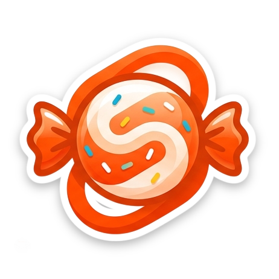

<p align="center">
  
</p>

# Sveet

Sveet is an opinionated, agent-first SvelteKit starter kit that's sweet like candy 🍭

```bash
bun create nerdwerk/sveet my-app && cd my-app
bun run sandbox
# → open http://localhost:4096 and say "set this project up"
```

If that made you curious, here's why Sveet exists.

While most things now are agent-first, this README is **human-first**, so please take your time to really read this. A human wrote this (me).

I've built a few production-grade apps with agents over the last couple of months, and I poured that experience PLUS years of general development and SaaS experience into Sveet. My little ninja [onelink.ninja](https://onelink.ninja) 🥷 runs on it, and whatever it learns in production flows back here.

## Why another starter?

Huh, tough questions right away. And you are right ... there are dozens of starters out there. But I often felt overwhelmed by how much gets shipped with them, and I kept bootstrapping from the default SvelteKit setup instead, grabbing for the same tech decisions again and again. So I built the starter kit I wish I had found.

**I'm not shipping all the features you might need ... I ship a few that make getting started easier.**

## It's self-reliant

There are only a few things I included and built into Sveet. But the main goal for me was that it's all super self-reliant and easy to ship projects fast, without selling your soul to one of the big hosters or services out there. I can break it down to SvelteKit + SQLite ... and some glue in between to make life sweeter. I deploy these apps often on fly.io because it's so darn easy, but you can deploy them wherever you want. And to make that happen ... talk to your agents. But read the next part before that.

## What does agent-first mean?

It's exactly that ... no one is going to write all the code alone anymore. So ... you won't find tons of documentation here, or plugins and all that jazz 🙈 to customize Sveet. Whatever I come up with will not be what you want and need. But your agents will know, so I handed them a neat AGENTS.md file and a bunch of useful skills you can use to boost your productivity and customize this project to your needs without dead code.

The best thing: if you want, you can run this whole thing in a sandbox right away, without being afraid that a rogue agent steals your SSH keys and everything else on your machine. (It can still see what's in the project folder, so keep production secrets out of it.) The next few lines will be a little more technical, so strap in and get ready.

## Is it for you?

Sveet is here to kickstart you, not to be a kitchen sink. It's not for you if you want to start inside a specific ecosystem like Supabase, Firebase or Convex, if you want lots of boilerplate done for you (billing, teams, dashboards), if you need Postgres or multiple servers from day one, or if you don't want to work with agents. Everyone else: welcome!

## The Sveet stack

So you might be asking what's included to make this thing delicious like candy 🍬

- **SvelteKit 3 + Svelte 5**, compiled by `adapter-bun` into a single executable 🏎️
- **bun** for everything: install, dev, build, tests, scripts
- **SQLite** via `bun:sqlite` + **Drizzle**: no database server, and committed migrations. (Migrations are GOLD!)
- **Better Auth** with passwordless **magic links**, behind one mail seam. In dev the links are printed to the log; for production, Scaleway TEM (Transactional Email) is ready. It's EU-hosted and has a free tier of up to 3,000 mails a month that just works.
- **[ui-sdk](https://ui-sdk.dev)** components themed by tokens, plus **Tailwind 4**. ui-sdk is a radical new way to build UIs with agents, and it fits right in here.
- **Vitest** (in-memory SQLite) and **Playwright** (the real build, a fresh database per test)
- **Docker → Fly.io**, SQLite on a volume, migrations on start
- **[microsandbox](https://microsandbox.dev)** dev VM with the dev server, tests and agents ([opencode](https://opencode.ai) by default)
- **Agent tooling**: `AGENTS.md`, the Svelte MCP, project skills, and [ponytail](https://ponytail.dev) so agents write the least code that works

Picks like Scaleway and Fly.io are opinionated, sensible defaults so you can ship on day one, not handcuffs. Want another mail provider or host? Eject and swap them: the `sveet-mail` and `sveet-deploy` skills walk your agent through it.

## Getting started

All that hopefully sounds nice already and you want to get started, so here's the fastest way to do that.

> **Heads-up: the sandbox is optional.** It needs an Apple Silicon Mac or Linux with KVM. Anywhere else, skip it and run everything with bun on your machine, see [Without the sandbox](#without-the-sandbox).

**1. Install what Sveet needs on your machine:** [bun](https://bun.com), [microsandbox](https://microsandbox.dev) (the dev VM) and, for deploys, [flyctl](https://fly.io/docs/flyctl/install/) (optional, but give it a shot if you don't know Fly yet). Either download the [Brewfile](https://raw.githubusercontent.com/nerdwerk/sveet/main/Brewfile) and run `brew bundle` next to it, or run:

```bash
brew install bun superradcompany/tap/microsandbox flyctl
```

**2. Create the project and boot its sandbox:**

```bash
bun create nerdwerk/sveet my-app   # or with the Svelte CLI, see below
cd my-app
bun run sandbox
```

The first boot takes a few minutes, because it installs the dependencies, the test browser and the agent inside the VM. After that, booting takes about a second. It prints:

```
  App       http://localhost:5173
  Agent     http://localhost:4096   user: opencode   password: …
```

**3. Open the agent at http://localhost:4096 and say "set this project up".** The `sveet-setup` skill asks for a name and a one-liner, then whether you want to deploy, how mail goes out and who will use it. Just trying things out? Say "no need to deploy" or "just the defaults" and you're done after two questions. Everything can be changed later. It then rewrites the project to match and runs the tests. Yes, it's that easy!

## The Svelte CLI

If you do NOT want to follow the path above, Sveet is also an [sv community add-on](https://svelte.dev/docs/cli/community). sv scaffolds its minimal SvelteKit project, and the add-on turns it into the same Sveet project you get from `bun create`. If you happen to have Node installed, npx will do the trick:

```bash
npx sv create my-app --template minimal --types ts --add @nerdwerk --install bun
```

Then `cd my-app && bun run sandbox`, as above. The add-on has the same version as the template it was built from.

## Working in the sandbox (read this one) 👁️👄👁️

Okay, here's really the technical part of this. While of course you can run the whole thing outside of the sandbox, it's good practice today to get into sandboxing things. Especially if you plan to use skills from all kinds of strangers.

```
    ┌────────────────────────────────────────────┐
👴🏼 <   It's dangerous to go alone! Take this. ⚔️ │
    └────────────────────────────────────────────┘
```

The sandbox is a small Linux VM that holds the dev server, the tests and the coding agent. The agent runs without permission prompts, but it can only reach your project folder and the public internet. The folder is mounted live, so your editor sees every change. The agent can't see the rest of your machine, your SSH keys or credentials, or your local network.

**Deploys deliberately stay outside.** `bun run deploy` refuses to run in the VM, so an agent can't ship to production by accident.

Here are all the commands to find your way around the sandbox:

| Command                        | Does                                                                        |
| ------------------------------ | --------------------------------------------------------------------------- |
| `bun run sandbox`              | Boot the VM (creating it the first time) and print the URLs                 |
| `bun run sandbox restart`      | Restart the dev server (`opencode` or `all` for the others)                 |
| `bun run sandbox logs`         | Follow the dev server log, where sign-in links appear (`logs opencode` too) |
| `bun run sandbox agent [name]` | A terminal agent in the VM: `opencode` (default), `claude`, `codex`         |
| `bun run sandbox shell`        | A shell inside the VM                                                       |
| `bun run sandbox zed`          | Print the Zed settings for using the VM's agent over ACP                    |
| `bun run sandbox stop` / `rm`  | Stop the VM / delete it, with its disks and agent logins                    |

**The dev server is always running.** It starts with the sandbox, and a crash brings it back within a second. `bun run db:reset` empties the database in place, so the server picks up the fresh data without a restart. For anything else, run `bun run sandbox restart`. The command is the same on your machine and inside the VM, so the agent can run it too.

### How to work with agents

- **opencode** is the default. It runs as a server in the VM with its web UI at `http://localhost:4096`, and `bun run sandbox agent` attaches a terminal to the same sessions. It works with almost any model provider: run `/connect` once and the login stays in the VM. It also comes with a few free models for trying it out.
- **Claude Code**: `bun run sandbox agent claude`. A Claude Pro or Max subscription only works in Anthropic's own tools, not in opencode, so use this agent for it. Run `/login` once inside the VM.
- **Codex**: `bun run sandbox agent codex`, with ChatGPT sign-in or an API key.

... and I guess a lot of others work in the same way, but I have not verified that.

> Logins stay on the VM's disk until `bun run sandbox rm`.

### Your editor with the VM's agent

Editors that speak the [Agent Client Protocol](https://agentclientprotocol.com) can drive the agent inside the VM. I use [Zed](https://zed.dev/) for that, and highly recommend that editor. Run `bun run sandbox zed` and paste the printed `agent_servers` block into Zed's settings. You keep Zed's agent panel, while the agent and every command it runs stay in the sandbox. The project is mounted at the same path in the VM as on your machine, so file paths match on both sides. If the sandbox isn't running, Zed boots it.

Contributions for other editors and setups are welcome 🤓

### Without the sandbox

Everything also runs directly on your machine with bun: `bun install && bun run setup && bun run dev`. The agent then has your user's full access, so keep its permission prompts on. This probably feels pretty familiar, so I won't go into too much detail.

## Daily loop

Here are the commands you'll use most.

| Command               | Does                                                  |
| --------------------- | ----------------------------------------------------- |
| `bun run verify`      | Lint + types + unit + e2e on the production build     |
| `bun run db:generate` | Migration from `src/lib/server/db/schema.ts`          |
| `bun run db:reset`    | Empty the DB in place, migrate and seed               |
| `bun run deploy`      | On your machine: `verify`, then `fly deploy`          |
| `bun run deps:update` | Dependency updates, committed only if `verify` passes |

Sign in at `/login` with `ada@example.com` (seeded). The magic link shows up in `bun run sandbox logs`. The full list of commands, the golden rules and the map of the code are in [AGENTS.md](AGENTS.md).

## How agents write code here

Sveet ships as little as possible, because your agent can add what you need in seconds. The same goes for what agents write: [ponytail](https://ponytail.dev) makes them use what's already there (the codebase, the platform, ui-sdk, the installed libraries) before writing anything new. It's always on in opencode, and `AGENTS.md` tells Claude Code and other agents to load it. Every feature gets an e2e test of its happy path. Unit tests are only for logic that's worth testing.

For customization, as stated above, instead of all kinds of plugins and demo code, we ship some skills.

Project skills (`.agents/skills/`) teach the flows: `sveet-setup`, `sveet-feature`, `sveet-deploy`, `sveet-mail`, `sveet-admin` and `sveet-upgrade`. See [AGENTS.md](AGENTS.md) for when each applies. But your agents already know what to do. 🤖🧠

## Deployments

Feel free to customize, but here I'll lay out how to get stuff shipped to fly.io. That said, I am looking to find a full european solution for this with a similarly nice dev experience.

`fly.toml` ships with the app name and `ORIGIN` empty, on purpose: fly refuses to deploy until they're set, so nothing ships under the wrong name. `sveet-setup` fills them in for you. Then run these on your machine, not in the sandbox:

```bash
fly apps create <app>
fly volumes create data --size 1 --region <region>
fly secrets set BETTER_AUTH_SECRET="$(openssl rand -base64 32)" SCW_SECRET_KEY=… SCW_DEFAULT_PROJECT_ID=…
bun run deploy
```

The image is one compiled executable plus `drizzle/` on debian-slim, with no bun and no `node_modules` at runtime. It's plain Docker, so it runs anywhere a container does. The `sveet-deploy` skill covers mail DNS, custom domains, scaling, backups and other hosts.

## Updating

A Sveet project is a copy, not a dependency, so updates are a merge. That's on purpose: you own every line, so nothing changes under your feet. `package.json` records the release you started from (`sveet.version`). Ask your agent to **"upgrade sveet"**: the `sveet-upgrade` skill diffs that release against the newest one and applies the parts that fit your project, such as tooling, fixes and skills.

## Support Sveet 🍭

Sveet is free and MIT licensed, and it stays that way. If it saves you time and you want to give something back, you can support my work on [Patreon](https://www.patreon.com/nerdwerk). It keeps me shipping these things, useful tools and explore new products and ideas.
Thank you! 💜

## License

MIT © Nerdwerk
