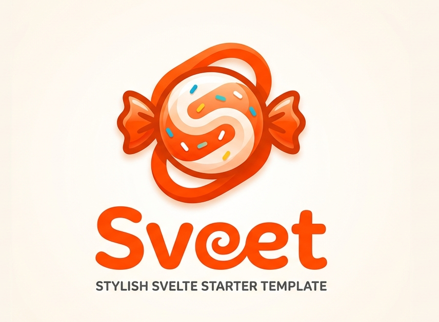

<p align="center">
  
</p>

# SVEET

An opinionated SvelteKit-starter-pack, delicious like sweets. 🍭
It's a batteries-included starter pack with a focus on AI-assisted development. You can Vibecode your next project and deploy it for the world to see in minutes.

This project is leveraging [bun](https://bun.sh), so I'll recommend getting

## Stack

- SvelteKit 2 + Svelte 5
- Drizzle ORM + `bun:sqlite`
- Better Auth
- shadcn-svelte + Tailwind 4
- bun + devbox
- Docker → Fly.io

## Start a new project

```bash
bunx giget@latest gh:nerdwerk/sveet my-app
cd my-app
```

Then either use [devbox](https://www.jetify.com/devbox) for a pinned toolchain:

```bash
devbox shell      # bun + node, exact versions
bun install
bun run setup     # generates .env, sets BETTER_AUTH_SECRET
bun run db:migrate
bun run dev
```

…or, if you already have bun:

```bash
bun install
bun run setup     # generates .env, sets BETTER_AUTH_SECRET
bun run db:migrate
bun run dev
```

Visit the app, then the **Auth demo** to try sign-up / sign-in.

You can also delete any files you don't need. The UI is not oppinionated, so you can customize it to your needs.

## Scripts

| Command                                      | Does                                                        |
| -------------------------------------------- | ----------------------------------------------------------- |
| `bun run setup`                              | Sets up the project, including .env and BETTER_AUTH_SECRET  |
| `bun run dev`                                | Dev server                                                  |
| `bun run build`                              | Production build (`adapter-node` → `build/`)                |
| `bun run db:generate`                        | Generate a SQL migration from `schema.ts`                   |
| `bun run db:migrate`                         | Apply migrations (runtime migrator — no drizzle-kit needed) |
| `bun run db:studio`                          | Drizzle Studio GUI                                          |
| `bun run db:reset`                           | Delete the local DB and re-migrate                          |
| `bun run auth:schema`                        | Regenerate the Better Auth schema after config changes      |
| `bun run check` · `lint` · `format` · `test` | Quality gates                                               |

## Database

The schema lives in `src/lib/server/db/schema.ts` as typed Drizzle tables.

**Workflow:**

1. Edit `schema.ts`
2. `bun run db:generate` → writes SQL into `drizzle/` (commit it)
3. `bun run db:migrate` → applies it

The database is a plain SQLite file addressed by `DATABASE_PATH` (`local.db` in dev,
`/data/sqlite.db` on the Fly volume in production), opened with bun's built-in
[`bun:sqlite`](https://bun.sh/docs/api/sqlite) driver in WAL mode. There's no native
module and no separate database server to run.

Because `bun:sqlite` only exists inside the bun runtime, `dev`, `build` and `preview`
all run as `bun --bun vite …`. Running them under `node`/`npm` will fail to resolve
`bun:sqlite`.

I am a big fan of Pocketbase, so there's also a `pocketbase` branch that swaps the
whole data + auth layer for PocketBase on PocketHost.

## UI & theming

Components come from [shadcn-svelte](https://www.shadcn-svelte.com). Add more with:

```bash
bunx shadcn-svelte@latest add card input label dialog
```

**Restyle everything** by editing the CSS variables in `src/routes/layout.css` (`:root` = light, `.dark` = dark). Base color is `neutral`. This might change as I'm exploring other color schemes and design systems, so keep an eye out for updates.

## AI tooling

- **Svelte MCP** — configured in `.mcp.json` (Claude Code), `.cursor/mcp.json`, `.vscode/mcp.json`. Gives agents live Svelte 5 / SvelteKit docs and an autofixer.
- **shadcn-svelte skill** — vendored in `.agents/skills/shadcn-svelte/`. Agents use it to add and compose components correctly.
- **`AGENTS.md`** — the operating guide agents read first.

## Deploy to Fly.io

The app is a Docker image (`adapter-node`, run by bun). SQLite is persisted on a Fly **Volume** at `/data`, and migrations run on container startup via `docker-entrypoint.sh` — not Fly's `release_command`, which doesn't mount the volume.

The runtime image contains no `node_modules` at all: Vite bundles the server, `bun build` bundles the migrator into a single `migrate.js`, and `bun:sqlite` comes from the runtime itself.

```bash
fly launch --no-deploy                                   # claim app name + region (edit fly.toml)
fly volumes create sveet_data --size 1 --region <region> # persistent SQLite storage
fly secrets set BETTER_AUTH_SECRET="$(openssl rand -base64 32)"
fly deploy
```

After launch, set `ORIGIN` in `fly.toml` to your real app URL (Better Auth needs it).

It's plain Docker underneath, so it runs anywhere a container does.

## License

MIT © Roman Kuba
